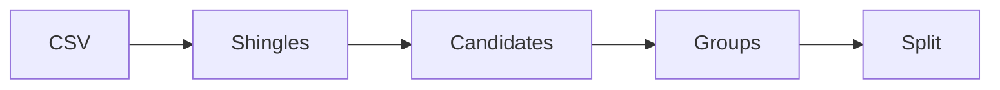

# Leakage Audit


Built by Kanak Prabhakar

Identify overlapping text across evaluation splits and export independent text groups.

## Features and architecture
Build three-word shingles, retrieve MinHash LSH candidates, verify exact Jaccard similarity, then union matching components before assigning groups to train or test.



## Installation and usage
From the extracted project directory, run `python -m pip install -r baselines.txt` in a Python 3.11+ virtual environment. After setup the analysis runs offline.

```sh
python audit.py example.csv audit-out
python -m pytest -q 
python bench.py
```

## Benchmark protocol
Input headers are id,text,split. Use unique IDs. Benchmark 60 seeded two-record families, half literal copies and half one-token edits. Count missed and false pairs and residual crossing families. The random baseline ignores identity, exact equality misses edits, and Deepchecks TrainTestSamplesMix operates on matching tabular rows. Cleanlab depends on the feature representation and neighbor threshold. TF-IDF loses phrase order. MinHash can miss paraphrases or borderline candidates. The full installation includes both external adapters.

| Method | Result on 60 labeled families |
|---|---|
| Random split | 18 families crossed splits |
| Exact-hash grouping | 12 crossed splits, 30/60 pairs detected |
| MinHash and exact Jaccard | 0 crossed splits, 60/60 pairs detected, 0 false pairs |
| Deepchecks TrainTestSamplesMix | 30/60 test rows found in train |
| cleanlab near-duplicates with TF-IDF | 30/60 pairs detected, 0 false pairs |

## Limitations and roadmap
Grouping can chain weakly related endpoints. Test fraction is by group, so large groups may skew row counts. Next evaluate labeled paraphrases.

## Resume
Accomplished duplicate-family separation as measured by TBD residual cross-split families by doing MinHash retrieval, exact Jaccard verification and group-aware splitting. Read the MinHash groups count from bench.py.

The evaluation uses 30 exact and 30 lightly edited pairs. These results characterize this fixture and feature representation. For the complete benchmark use Python 3.12 and the single install command above. The constant format_version field in the Deepchecks adapter preserves text equality.

## Credits
[datasketch](https://ekzhu.com/datasketch/), [Deepchecks](https://github.com/deepchecks/deepchecks), [cleanlab](https://github.com/cleanlab/cleanlab), [scikit-learn](https://scikit-learn.org/), [pytest](https://pytest.org/).

## Publish
Run in PowerShell 7 or Bash from the repository root.
```sh
git init -b main && git add . && git -c user.name="Kanak Prabhakar" -c user.email="kanakprabhakar72@gmail.com" commit -m "Add Leakage Audit" && gh repo create Kanak234/leakage-audit --public --source=. --remote=origin --push
```

## Presentation

1. I began with a CSV of labeled train and test examples.
2. In audit.py I shingled text and retrieved candidates with MinHash.
3. I checked the exact Jaccard score and exported shared phrases so a reviewer could verify the match.
4. I assigned whole connected components to splits and tested this in test_audit.py.
5. I compared detected pairs and residual leakage using bench.py.

**Main limitation.** Word-shingle overlap can miss paraphrases and connect chains of weakly related texts.


See edge-cases.md for tested inputs and tests-output.txt for actual Windows pytest output.
