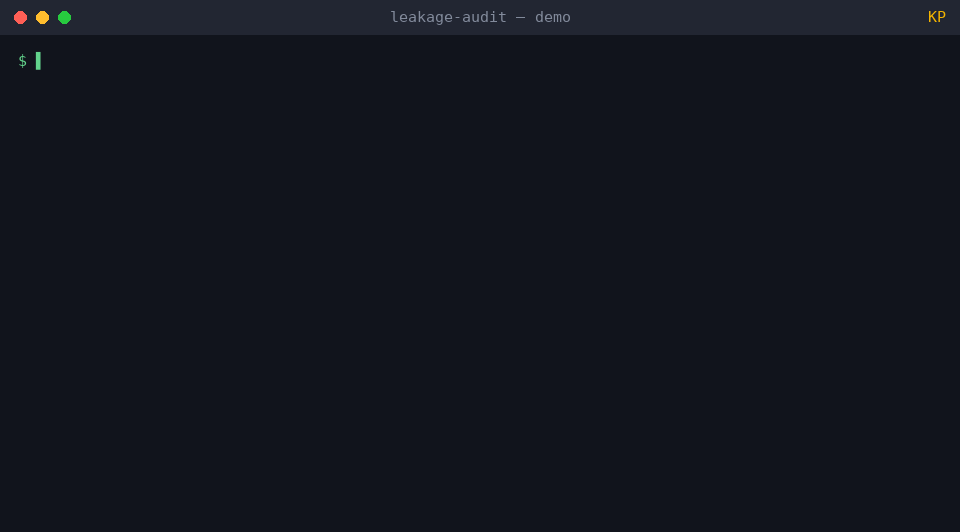
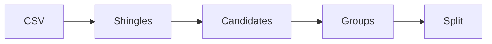

# Leakage Audit


Built by Kanak Prabhakar

Identify overlapping text across evaluation splits and export independent text groups.



The demo shows real output. Records 1 and 2 are the same sentence, one in train and one in test. The audit reports the overlap and puts both in the same group, on the same side of the new split.

## Features and architecture
Build three-word shingles, retrieve MinHash LSH candidates, verify exact Jaccard similarity, then union matching components before assigning groups to train or test.



## Installation and usage
There are two install levels, and the README used to mix them up:

| You want | Install | Python |
|---|---|---|
| The audit tool and the core benchmark rows (random / exact hash / MinHash) | `python -m pip install -r requirements.txt` | 3.11+ |
| The full benchmark, including the Deepchecks and cleanlab comparison rows | `python -m pip install -r baselines.txt` (includes requirements.txt) | 3.11 or 3.12 only. The pinned scikit-learn 1.5.2, pyarrow 16.1 and Deepchecks 0.19.1 have no Python 3.13 wheels. |

After setup the analysis runs offline. Without the baseline packages, `bench.py` still prints the core rows and reports the adapters as unavailable.

```sh
python audit.py example.csv audit-out
python -m pytest -q 
python bench.py
```

## Benchmark protocol
Input headers are id,text,split. Use unique IDs. Benchmark 60 seeded two-record families, half literal copies and half one-token edits. Count missed and false pairs and residual crossing families. The random baseline ignores identity, exact equality misses edits, and Deepchecks TrainTestSamplesMix operates on matching tabular rows. Cleanlab depends on the feature representation and neighbor threshold. TF-IDF loses phrase order. MinHash can miss paraphrases or borderline candidates. The full installation includes both external adapters.

| Method | Result on 60 labeled families |
|---|---|
| Random split | 18 families crossed splits |
| Exact-hash grouping | 12 crossed splits, 30/60 pairs detected |
| MinHash and exact Jaccard | 0 crossed splits, 60/60 pairs detected, 0 false pairs |
| Deepchecks TrainTestSamplesMix | 30/60 test rows found in train |
| cleanlab near-duplicates with TF-IDF | 30/60 pairs detected, 0 false pairs |

## Limitations and roadmap
Grouping can chain weakly related endpoints. Test fraction is by group, so large groups may skew row counts. Next evaluate labeled paraphrases.

## Resume line
Accomplished leak-free train/test splits with 0 of 60 duplicate families crossing splits (random split: 18, exact-hash grouping: 12) and 60/60 near-duplicate pairs found with 0 false pairs, as measured by `bench.py` on 60 seeded families, by doing MinHash LSH retrieval, exact Jaccard verification and union-find group splitting.

The evaluation uses 30 exact and 30 one-token-edited pairs, so it is an easy fixture. The numbers describe this fixture only. Paraphrases are the known gap (see Limitations). For the complete benchmark use Python 3.12 and `baselines.txt`. The constant format_version field in the Deepchecks adapter preserves text equality.

## Credits
[datasketch](https://ekzhu.com/datasketch/), [Deepchecks](https://github.com/deepchecks/deepchecks), [cleanlab](https://github.com/cleanlab/cleanlab), [scikit-learn](https://scikit-learn.org/), [pytest](https://pytest.org/).

## Presentation

1. I began with a CSV of labeled train and test examples.
2. In audit.py I shingled text and retrieved candidates with MinHash.
3. I checked the exact Jaccard score and exported shared phrases so a reviewer could verify the match.
4. I assigned whole connected components to splits and tested this in test_audit.py.
5. I compared detected pairs and residual leakage using bench.py.

**Main limitation.** Word-shingle overlap can miss paraphrases and connect chains of weakly related texts.


See PRD.md, TRD.md and edge-cases.md for the design, and tests-output.txt / results.txt for the latest runs.
